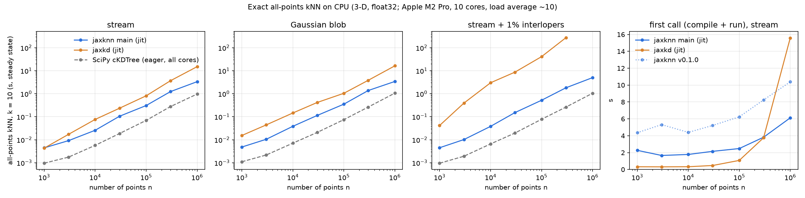
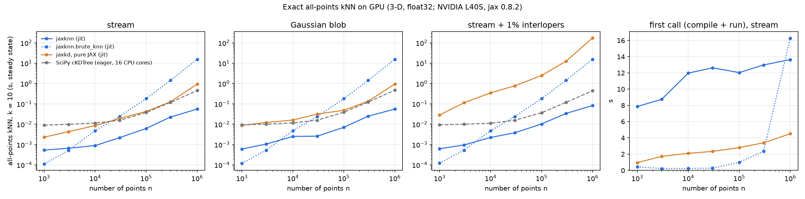
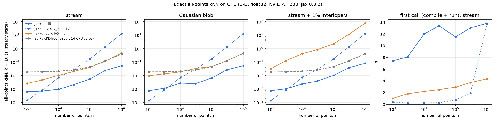

# How jaxknn compares

jaxknn is an exact kd-tree kNN that lives inside traced JAX programs. The closest alternatives are [jaxkd](https://github.com/dodgebc/jaxkd), another JAX kd-tree, and SciPy's [`cKDTree`](https://docs.scipy.org/doc/scipy/reference/generated/scipy.spatial.cKDTree.html), which can't be traced but is fast on CPU. This page sets out what jaxknn does differently, how fast it is, and what it costs.

## What jaxknn does differently

- **Exact, deterministic ties.** Equidistant neighbours go to the lower index, identically eagerly and under `jit`, independent of tree layout and padding. The tests check this against a float64 brute-force oracle on Gaussian, stream, integer-grid and duplicate-clump data.
- **Robust to scattered outliers.** On a stream with 1% uniformly scattered interlopers, jaxkd's query time grows steeply: ~40 s at n = 100k and ~275 s at 300k, against 0.5 s and 1.8 s for jaxknn (third panel below).
- **No float32 overflow or underflow.** Coordinates are divided by an exact power of two when float32 squared distances would overflow or underflow. For example, metres at kiloparsec scale (~3e19) keep their neighbours. Dividing by a power of two is exact, so neighbour selection, ties included, is unchanged.
- **Traceable.** Works under `jit`, `vmap` and `grad`. Gradients go through a plain gather, and are 0 rather than NaN at coincident points. See [use it under `jit`, `vmap` and `grad`](how-to/use-under-jit-vmap-grad.md).
- **Eager size buckets.** Eager calls pad n to a bucket (2ʲ or 1.5·2ʲ), so differing sizes share compiled code.
- **Label-excluding queries.** `knn(tree, q, k, exclude=(point_labels, query_labels))` returns the nearest point with a *different* label and prunes same-label subtrees. See [find the nearest point with another label](how-to/find-the-nearest-point-with-another-label.md).

[How it works](how-it-works.md) explains the mechanics behind each of these.

## Benchmarks on CPU



All-points kNN, k = 10, 3-D float32, n from 1,000 to 1,000,000. jaxknn and jaxkd ran under `jit`, steady state (best of 3); SciPy's `cKDTree` ran eagerly on all cores. The machine was an Apple M2 Pro (10 cores) under load (load average ~10), so the ratios matter more than the absolute times. Versions: jaxknn `main` at f093366, jax 0.8.2, jaxkd 0.1.2, SciPy 1.18.1. [Script](https://github.com/nstarman/jaxknn/blob/7f53c418cc8434cd075c5ed2d0a08de634b2e284/bench.py), [plotting script](https://github.com/nstarman/jaxknn/blob/7f53c418cc8434cd075c5ed2d0a08de634b2e284/plot.py) and [raw numbers](https://github.com/nstarman/jaxknn/blob/7f53c418cc8434cd075c5ed2d0a08de634b2e284/results_f093366.json).

Reading the panels, left to right:

1. **Stream** (a thin, curved 3-D stream). jaxknn and jaxkd tie at n = 1,000 (4.4 ms against 4.3 ms); from 3,000 up, jaxknn is 1.9–4.5× faster.
2. **Gaussian blob.** jaxknn is 2.8–4.8× faster than jaxkd at every size.
3. **Stream + 1% interlopers** (the stream, with 1% of points scattered uniformly around it). jaxknn slows modestly against the clean stream (0.52 s against 0.31 s at 100k). jaxkd's time grows steeply, to 41 s at 100k and 274 s at 300k; its curve stops there because that point alone took 4.5 minutes.
4. **First call** (compile and run) on the stream. This is jaxknn's weak spot, covered below. The dotted line is jaxknn v0.1.0, for reference.

In all three timing panels, SciPy is below both JAX libraries.

| n = 100,000, steady state | jaxknn | jaxkd | SciPy |
|---|---|---|---|
| stream | 0.31 s | 0.81 s | 0.07 s |
| Gaussian blob | 0.35 s | 1.05 s | 0.08 s |
| stream + interlopers | 0.52 s | 41 s | 0.08 s |

## Benchmarks on GPU

### NVIDIA L40S



The same data, sizes and timing as the CPU benchmark, on one NVIDIA L40S (MIT Engaging): jaxknn `main` at f093366, jax 0.8.2 with CUDA 12, jaxkd 0.1.2 (pure JAX). It adds [`jaxknn.brute_knn`][], with SciPy's `cKDTree` on the node's 16 CPU cores for reference. Every jaxknn result matched SciPy's distances. [Script](https://github.com/nstarman/jaxknn/blob/0cad0d17e3d09db28e276100c10f61a08875cad3/gpu/bench_gpu.py), [Slurm job](https://github.com/nstarman/jaxknn/blob/0cad0d17e3d09db28e276100c10f61a08875cad3/gpu/job.sh), [plotting script](https://github.com/nstarman/jaxknn/blob/0cad0d17e3d09db28e276100c10f61a08875cad3/gpu/plot_gpu.py) and [raw numbers](https://github.com/nstarman/jaxknn/blob/0cad0d17e3d09db28e276100c10f61a08875cad3/gpu/results_NVIDIA_L40S_26373681.json).

On a GPU the picture changes:

- **jaxknn is the fastest of the four at scale.** It's 5–17× faster than jaxkd on clean data, at every size from 1,000 to 1,000,000 points, and 5–8× faster than SciPy at 1M points.
- **jaxkd's interloper slowdown is still there:** 175 s at 1M points, against 83 ms for jaxknn.
- **Brute force wins only for small inputs,** below about 3,000 points: 0.1 ms against 0.5 ms for the tree at 1,000. It grows as n², to 15 s at 1M.

| steady state | jaxknn | jaxknn brute force | jaxkd (pure JAX) | SciPy (16 cores) |
|---|---|---|---|---|
| stream, n = 100k | 6.2 ms | 181 ms | 42 ms | 38 ms |
| stream + interlopers, n = 100k | 10 ms | 181 ms | 2.5 s | 37 ms |
| stream, n = 1M | 55 ms | 15 s | 944 ms | 455 ms |
| Gaussian blob, n = 1M | 56 ms | 15 s | 955 ms | 474 ms |
| stream + interlopers, n = 1M | 83 ms | 16 s | 175 s | 442 ms |

### NVIDIA H200



The setup is the same as on the L40S, on one NVIDIA H200, a datacenter GPU; again every jaxknn result matched SciPy's. [Raw numbers](https://github.com/nstarman/jaxknn/blob/08bfe469bc4a8440fa534d15abbe5a199cb9166a/gpu/results_NVIDIA_H200_26373138.json) and [job log](https://github.com/nstarman/jaxknn/blob/08bfe469bc4a8440fa534d15abbe5a199cb9166a/gpu/log_NVIDIA_H200_26373138.txt).

| n = 1M, steady state | jaxknn | jaxknn brute force | jaxkd (pure JAX) | SciPy (16 cores) |
|---|---|---|---|---|
| stream | 53 ms (L40S: 55) | 13 s (15) | 454 ms (944) | 401 ms (455) |
| stream + interlopers | 82 ms (83) | 13 s (16) | 77 s (175) | 415 ms (442) |

- **jaxknn barely changes between the two GPUs:** 53 ms against 55 ms at 1M points. jaxkd gets twice as fast on the H200, and brute force about 16% faster. That suggests jaxknn's GPU time is bound by its sequential query chunks and kernel launches rather than by compute; see [on GPU](#on-gpu).
- **jaxknn is still the fastest at scale:** 4–14× faster than jaxkd on clean data at every size, and 5–8× faster than SciPy at 1M points.
- **The first call takes about as long as on the L40S:** ~7–14 s on the H200, against ~8–14 s on the L40S.

jaxkd also has a CUDA path (`cuda=True`, from the `jaxkd-cuda` extension), which isn't in either run: when the benchmark ran, `jaxkd-cuda` 0.0.0 on PyPI was a source package that failed to build ("project.version is not specified", see the [job log](https://github.com/nstarman/jaxknn/blob/0cad0d17e3d09db28e276100c10f61a08875cad3/gpu/log_NVIDIA_L40S_26373681.txt)).

## Trade-offs

### Compile time

The first call compiles. On the CPU benchmark's stream it takes 1.7–3.8 s up to 300k points, against about a second or less for jaxkd up to 100k; at 300k the two are level. At 1M points the run time dominates and jaxknn's first call is faster (6.1 s against 15.6 s). On the L40S it's slower: ~8–14 s, against ~1–4.5 s for jaxkd.

That cost is paid once per program, not once per tree. The compiled program depends only on shapes and settings (n, d, dtype, `k`, `leaf_size`, `frontier`), never on the points. Measured on CPU at n = 100k; JAX's caching rules are the same on GPU:

- **New points reuse it,** even with a very different distribution or scale: 2.7 s for the first call under `jit`, then 0.42 s on new points.
- **So do new trees.** A jitted [`jaxknn.tree.knn`][] query took 1.7 s on its first tree and 0.02 s on a tree built from different points.
- **Eagerly, any n in the same size bucket reuses it.** 100k, 110k and 120k points share one compile (3.3 s, then 0.8 s).
- **`vmap` compiles one program for a whole batch,** and inside a larger `jit` the kNN compiles once, as part of that program.
- **What does recompile:** a different n under `jit` (there's no bucketing there), a different `k`, dtype or device.

To reuse the compiled program across processes, turn on JAX's [persistent compilation cache](https://docs.jax.dev/en/latest/persistent_compilation_cache.html):

```bash
export JAX_COMPILATION_CACHE_DIR="$HOME/.cache/jax"
```

Or, in Python, call `jax.config.update("jax_compilation_cache_dir", ...)` before the first call. This works for eager calls and for the raw tree: a second process's first call took 1.6 s against 3.6 s.

It doesn't, by default, for `jax.jit` around [`jaxknn.knn`][] or [`jaxknn.brute_knn`][]. Under tracing, their finite-input check is an `equinox.error_if`, which is a host callback, and JAX doesn't cache programs that contain one. Setting `EQX_ON_ERROR=nan` makes them cacheable (3.7 s, then 1.2 s), at the cost of NaN output instead of an error on non-finite input.

### SciPy is faster on CPU

When you don't need tracing, SciPy's `cKDTree` is 3–8× faster than jaxknn on the CPU benchmark, and compiles nothing. On a GPU it's the other way round: jaxknn is 5–8× faster than SciPy on 16 CPU cores at 1M points. See [when to use SciPy instead](when-to-use-scipy-instead.md).

### On GPU

jaxknn was developed and tuned on CPU/XLA: its query-chunk and overflow-tier sizes, and its selection networks, were chosen for CPU. It's already the fastest of the four on both GPUs measured, but GPU-specific tuning hasn't been tried, and the H200 suggests there's room. The H200 has over 5× the L40S's memory bandwidth, and it barely speeds jaxknn up, while it doubles jaxkd's speed. That points at the query's sequential chunks and many small kernel launches, not at arithmetic or memory traffic. Open questions:
- **jaxkd's CUDA path** hasn't been measured against it.
- **float64** runs at a small fraction of float32's speed on workstation GPUs like the L40S (on datacenter GPUs like the H200, at half).
